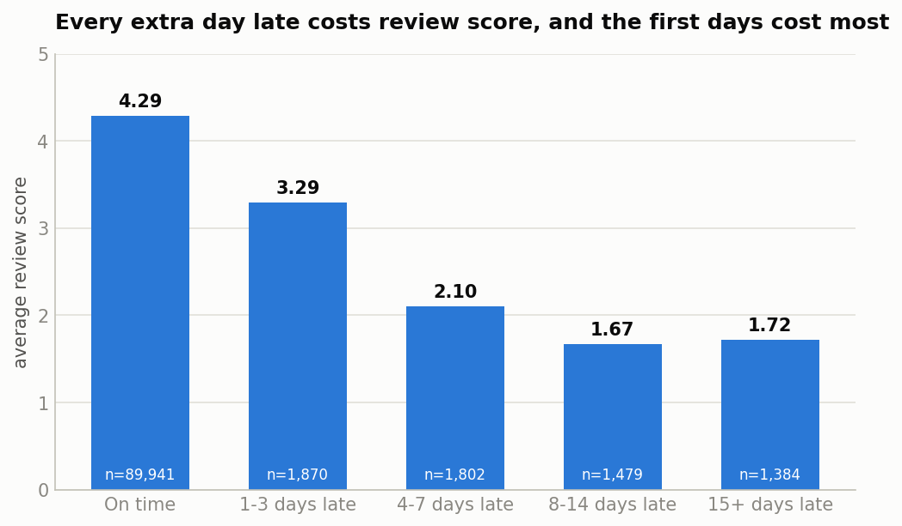
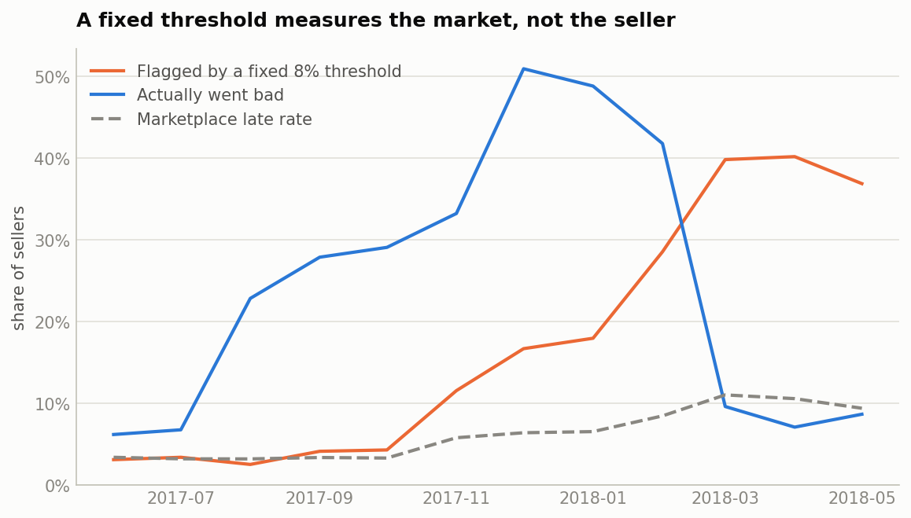
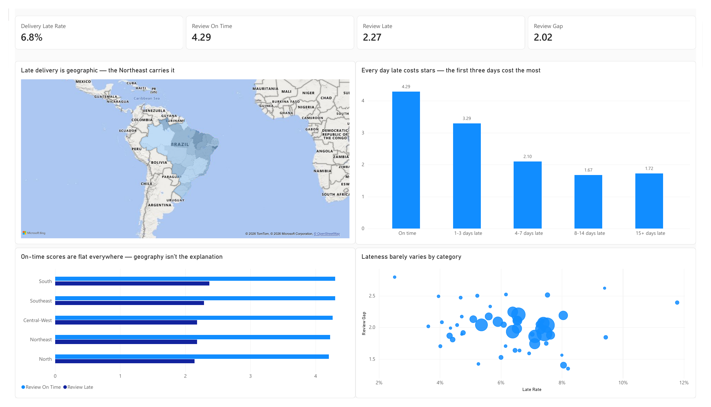

# Olist Marketplace Health & Seller Risk

[](https://github.com/Harshit0998/olist-marketplace-health/actions/workflows/ci.yml)
[](https://harshit0998.github.io/olist-marketplace-health/)

**What do late deliveries cost a marketplace?** An end-to-end analysis of 99,441 orders
on [Olist](https://www.kaggle.com/datasets/olistbr/brazilian-ecommerce), Brazil's largest
e-commerce marketplace, 2016–2018.

**[Read the full report →](https://harshit0998.github.io/olist-marketplace-health/)**

---

## What I found

**Late delivery destroys reviews.** On-time orders average **4.29 stars**, late ones
**2.27**. Nine percent of on-time orders score one or two stars; **62%** of late ones do.
The damage is front-loaded — a delivery three days late already costs a full star, and
being two weeks late costs barely more than being one week late.



**It does not measurably cost repeat purchases — because there are none to lose.**
Only 3.1% of customers ever order twice. Cohort retention looked like it was collapsing,
from 4.8% to 0.7%; at a fixed three-month horizon it is **flat at 1.09%**. The collapse
was an artefact of how long each cohort had been observed, not of customer behaviour.

**So the cost is acquisition damage, not churn** — roughly 4,050 one- and two-star
reviews on late orders, about 3,450 of them in excess of the on-time base rate. On a
marketplace where 97% of customers never return, reputation is the asset at risk.

## Two things that went wrong

**A definitional defect that inverted a conclusion.** `estimated_delivery_date` is a date
and `delivered_at` is a timestamp, so every same-day delivery compared as late — 1,292
orders misclassified. It surfaced only from cross-checking a boolean flag (7,827 late)
against the delay-day bands (6,535) and refusing to accept the gap. Correcting the
measurement error made the effect **larger**.

**A risk rule that failed out of time.** A fixed threshold — flag any seller above 8%
late — scored a lift of **2.11** on the training period and **1.12** on the holdout.
The marketplace late rate had tripled between the two, so the rule had learned that 8%
was unusual: a fact about 2017, not about sellers. Ranking sellers *within* each month
scored worse in training, 1.60, and held at **1.51**.



The rule that looked better in training is the one that failed. The lesson is now a test
that breaks the build, not a paragraph someone might skip.

## What's in here

| | |
|---|---|
| **[Findings](https://harshit0998.github.io/olist-marketplace-health/docs/findings.html)** | The full analysis, eight sections, with what it cannot claim |
| **[Experiment design](https://harshit0998.github.io/olist-marketplace-health/docs/experiment_design.html)** | An A/B test sized against the real population — and one design killed for being underpowered |
| **[Dashboard](powerbi/)** | Three pages in Power BI, 20 measures, built on the tested marts |
| **[Models](olist_dbt/models/)** | 8 staging views, 11 marts, 123 tests |



## How it is built

dbt + DuckDB for the models, Python for the risk work and the figures, Power BI for the
dashboard, Quarto for the report. **123 tests run on every push**, against a sample
committed to this repository — so the badge above is checkable, not a claim.

Two tests are worth a look because generic ones could not express them:

- [`assert_no_future_in_observation`](olist_dbt/tests/assert_no_future_in_observation.sql) —
  proves no feature in the risk panel was built from data that post-dates its snapshot.
  Verified by deliberately breaking the model and confirming it fires.
- [`assert_watchlist_flag_rate_stable`](olist_dbt/tests/assert_watchlist_flag_rate_stable.sql) —
  fails the build if the watchlist's size drifts with market conditions. The rule it
  replaced would fail it on sight.

Every figure is regenerated from the models by [`scripts/05_charts.py`](scripts/05_charts.py),
so a chart cannot quietly disagree with the data behind it.

## Reproduce

**From the committed sample** — needs nothing but this repository (3.5 MB, ten sellers;
proves the pipeline, does not reproduce the numbers above):

```bash
pip install -r requirements-ci.txt
python scripts/01_load_raw.py --sample --db olist_ci.duckdb
cd olist_dbt && dbt deps && dbt build --target ci
```

**From the full dataset:**

```bash
# download the 9 CSVs from Kaggle into data/raw/ first
pip install -r requirements.txt
python scripts/01_load_raw.py
python scripts/02_profile.py
cd olist_dbt && dbt deps && dbt build
```

## Layout

| Path | What |
|---|---|
| `olist_dbt/models/staging/` | 8 views — one per source table, light cleaning only |
| `olist_dbt/models/marts/` | 11 tables — the business-ready models |
| `olist_dbt/tests/` | Singular tests that generic ones cannot express |
| `scripts/` | Load · profile · sample · BI export · watchlist · charts · power analysis |
| `docs/` | Findings, metrics, data-quality log, experiment design, figures |
| `powerbi/` | `.pbix`, `.pbit` and an exported PDF |
| `data/sample/` | The committed slice CI builds against |

`data/raw/` and `data/bi/` are not committed; `data/sample/` is.

## Credit

Dataset: [Olist Brazilian E-Commerce Public Dataset](https://www.kaggle.com/datasets/olistbr/brazilian-ecommerce),
published by Olist under CC BY-NC-SA 4.0. The slice in `data/sample/` is a subset of it.
