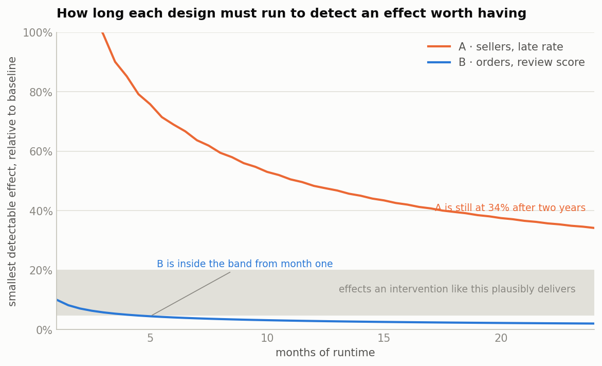

# Experiment design: can a warning recover some of the review damage?

Everything else in this project is observational. This is the design for the one
thing observation cannot settle — whether an intervention actually *causes* an
improvement.

It is a design, not a result. The Olist data is historical and nobody randomised
anything, so no experiment can be run on it. What *can* be done, and what makes this
worth more than the usual template, is that **every input below is measured from the
marts rather than assumed.** `scripts/06_power.py` recomputes all of it.

---

## 1. The intervention

Section 4 established the prize: late orders average **2.27 stars against 4.29 on
time**, and 62% of late orders score one or two stars against 9% of on-time ones.
The gap is 2.02 stars across roughly 6,500 late orders a year.

Some of that is the lateness itself and nothing can be done about it inside the
review window. But some of it is plausibly the *surprise* — a customer who was
promised Tuesday, heard nothing, and found out by the parcel not arriving. The
intervention tests that part:

> When an order is at elevated risk of running late and has not shipped by its
> expected ship date, send the customer a proactive message with a revised estimate
> and an apology, before the promise is broken.

If unmet expectation is doing part of the damage, resetting the expectation should
recover part of the gap. If the damage is entirely the delay itself, it will not,
and that is worth knowing before anyone builds the feature.

## 2. Why a control group is not optional here

The obvious cheap study is before-and-after: take the sellers on the watchlist,
intervene, and compare their late rate afterwards. The panel says exactly what that
would produce.

| Group | Late rate when observed | Late rate a quarter later | Change |
|---|---|---|---|
| Flagged (worst 15%) | 14.7% | 9.8% | **−4.9 points** |
| Not flagged | 5.1% | 6.9% | +1.8 points |

**Flagged sellers improve by a third with no intervention whatsoever.** They are
selected for being extreme, and extremes revert. An uncontrolled study of any
intervention on this population would report a large win that was entirely
regression to the mean — and the surrounding market was moving the other way at the
same time, which would have made the result look better still.

The correlation between a flagged seller's late rate before and after is **−0.17**:
within the selected group, the worse you were, the more you improve. That is the
signature of selection, not of treatment.

## 3. Two designs, and why the obvious one is dead

**Design A — randomise the sellers.** Put the flagged sellers into treatment and
control, coach the treated ones, measure next-quarter late rate.

It is the natural design and it cannot work at this marketplace's scale. The
watchlist produces about **ten distinct sellers a month**, and between-seller
variation in late rate is large (SD 9.2 points against a 9.8% mean). Twelve months
of accrual gives 59 sellers per arm, where the smallest detectable effect is **4.8
percentage points — a 48% relative reduction.** No coaching programme delivers that.
Detecting a plausible 20% improvement would need **346 sellers per arm**, which is
nearly three years of accrual, by which time the marketplace is a different place.

CUPED — using each seller's pre-period rate as a covariate — is the standard rescue
and it does not help here either: the before/after correlation is negative, so it
removes about 3% of the variance.

**Design A should be killed at the design stage.** An experiment that cannot detect
an effect anyone would act on is not a cheap experiment, it is an expensive way to
produce a null result that means nothing.

**Design B — randomise the orders.** Same population, finer unit. Every order placed
with a seller on that month's watchlist is randomised; treated orders get the
warning.

This works because the unit count is two orders of magnitude larger. The watchlist
sellers generate about **522 reviewed orders a month**, and — usefully — those orders
run late **16.6% of the time against a marketplace rate of 6.8%.** The D6 watchlist
is doing real work here: it concentrates the population 2.4×, so the experiment is
not mostly spent on orders that were never going to be late.

## 4. The design

**Unit of randomisation:** the order. Assigned at purchase, by hashing the order id
with a fixed salt, so assignment is deterministic, reproducible, and independent of
anything that happens later.

**Eligibility:** orders placed with a seller on the current month's watchlist. Fixed
at purchase time and never re-evaluated — a seller leaving the watchlist mid-flight
does not remove their orders from the experiment.

**Allocation:** 50/50. Nothing here justifies an unequal split; equal allocation is
the most efficient when the two arms have similar variance.

**Primary metric:** mean review score across *all* randomised orders — the
intention-to-treat estimate. One primary metric, fixed in advance.

**Duration:** three months, fixed before launch. That gives about **780 orders per
arm and a smallest detectable effect of 0.22 stars**, against a 2.02-star gap. A
quarter of the gap recovered would be detected comfortably; a tenth would not.

**Guardrails**, each with a pre-set threshold that halts the test rather than merely
being reported: order cancellation rate, support contact rate, GMV per order, and
seller-side late rate (the warning must not change what sellers do).

**Sample ratio check** before anything else is read. If the arms are not within
chance of 50/50, assignment is broken and the result is uninterpretable regardless
of how good it looks.

## 5. How it is analysed

Two-sample t-test on mean review score, two-sided, α = 0.05. With ~780 per arm the
central limit theorem covers the fact that review scores are a lumpy five-point
scale, and a Mann-Whitney test is pre-registered as a robustness check rather than
as an alternative to be reached for if the t-test disappoints.

**Intention-to-treat is primary.** Every randomised order counts in the arm it was
assigned to, including the ~83% that arrive on time and for whom the warning never
fires. That dilutes the effect, and it is still the right primary analysis, because
the decision being made is "ship this feature to everyone eligible or not" — not
"does the message work on the subgroup that received it".

**The late-only comparison is secondary, and the reason is the interesting part.**
Lateness is determined *after* randomisation. Conditioning on a post-randomisation
variable breaks the guarantee randomisation gives you, and it is only defensible if
the treatment cannot affect that variable. A message to a buyer does not move a
parcel, so it probably cannot — but a warned buyer might cancel, which would change
who ends up in the late group. That is why cancellation rate is a guardrail and not
an afterthought: it is the thing that would invalidate the secondary analysis.

**No peeking.** The horizon is fixed at three months. Repeatedly testing an
accumulating sample and stopping at the first significant result inflates the false
positive rate well past 5%. If a mid-flight read is wanted, it should be an
alpha-spending or sequential design chosen before launch, not a decision taken when
the numbers start looking good.

## 6. What would make this wrong

**Interference.** Orders are independent, but sellers are not: a seller receiving
many warnings about their orders might change behaviour, which would contaminate
their control-arm orders. The seller-side late-rate guardrail is what detects it. If
it moves, the unit of randomisation has to become the seller, and Design A's power
problem comes back.

**Novelty.** A new notification gets attention partly because it is new. A
three-month horizon is long enough to see decay; a two-week test would not be.

**Seasonality.** The November 2017 backlog is a reminder that this marketplace has
months unlike other months. Randomisation handles it — both arms experience the same
November — but the *effect size* measured during a capacity crisis may not
generalise to a calm quarter, and the write-up should say which quarter it ran in.

**The metric is not the goal.** Review score is a proxy for customer experience and
it is measured only on the orders whose customers choose to review. If the warning
changes *who* reviews rather than what they say, the estimate shifts without the
experience changing. Response rate is therefore reported alongside the primary
metric.

## 7. If Design B also failed

It does not here, but the honest order of escalation if it had: increase eligibility
(flag the worst 30% rather than 15%, accepting a less concentrated population), then
switch the primary metric to the low-review-share — a binary with more signal per
order than a mean — and only then consider a longer horizon. Lengthening the test is
the last resort, not the first, because a six-month experiment is a six-month delay
to the decision.

---

*Reproduce every number above:* `python scripts/06_power.py`
