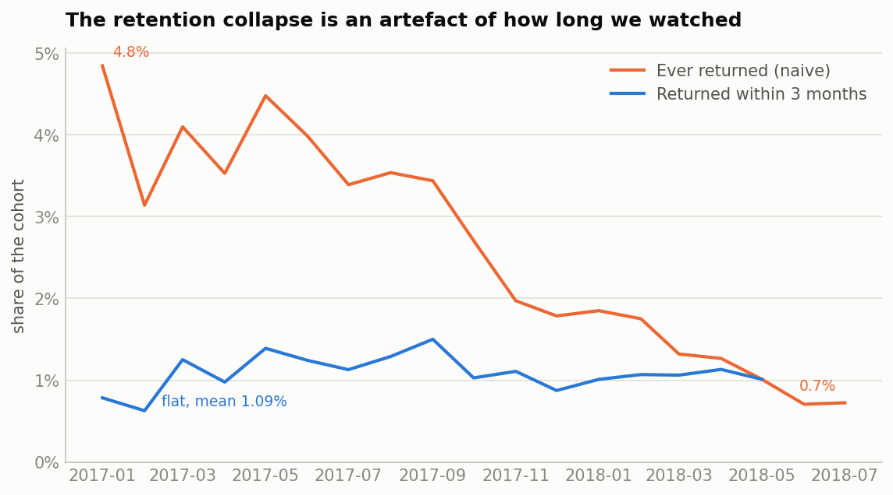

A full analytics build on the [Olist](https://www.kaggle.com/datasets/olistbr/brazilian-ecommerce)
Brazilian e-commerce dataset: 19 tested models in dbt and DuckDB, a three-page Power BI
dashboard, and a monthly seller risk watchlist — with the reasoning kept in the open,
including the parts that went wrong.

[Read the findings](docs/findings.md){.btn .btn-primary} &nbsp;
[Source on GitHub](https://github.com/Harshit0998/olist-marketplace-health){.btn .btn-outline-secondary}

## The question

What do late deliveries cost this marketplace?

## The answer, in three parts

**Late delivery destroys reviews.** On-time orders average **4.29 stars**, late ones
**2.27**. Nine percent of on-time orders score one or two stars; **sixty-two percent**
of late ones do. The damage is front-loaded — most of it lands in the first three days
past the promise.

{fig-alt="Bar chart of average review score by lateness band"}

**It does not measurably cost repeat purchases — because there are none to lose.**
Only 3.1% of customers ever order twice. The apparent collapse in retention across
cohorts turned out to be an artefact of how long each cohort had been observed; at a
fixed three-month horizon it is flat at 1.09%.

{fig-alt="Two lines: naive ever-returned declining, fixed three-month retention flat"}

**So the cost is acquisition damage, not churn** — roughly 4,050 one- and two-star
reviews attributable to late delivery, of which about 3,450 are in excess of the
on-time base rate.

## Two things that went wrong, and what they taught

**A definitional defect.** `estimated_delivery_date` is a date and `delivered_at` is a
timestamp, so every same-day delivery compared as late. 1,292 orders were misclassified.
It surfaced from cross-checking a boolean flag (7,827) against the delay-day bands
(6,535) and refusing to accept the gap. Correcting the measurement error made the
effect **larger**, not smaller.

**A risk rule that failed out of time.** A fixed threshold — flag any seller above 8%
late — scored a lift of 2.11 on the training period and 1.12 on the holdout. The
marketplace late rate had tripled, so the rule had learned that 8% was unusual, which
is a fact about 2017 rather than about sellers. Ranking sellers within each month
scored *worse* in training, 1.60, and held at 1.51.

{fig-alt="Three lines showing a fixed threshold inverting against the outcome it predicts"}

The rule that looked better in training is the one that failed.

## The dashboard

{fig-alt="Power BI dashboard page showing delivery and review analysis"}

Three pages in Power BI, built on the tested marts rather than re-deriving metrics in
DAX — which caught four errors in the written analysis along the way.

## How it is built

| Layer | What |
|---|---|
| Ingest | 9 Kaggle CSVs into DuckDB |
| Transform | 8 staging views, 11 marts, dbt + DuckDB |
| Test | 123 tests, run on every push by CI |
| Report | this site, rendered from the repo |
| Dashboard | Power BI, three pages, 20 measures |

Every figure on this site is regenerated from the models by `scripts/05_charts.py`,
so a chart cannot quietly disagree with the data behind it.
